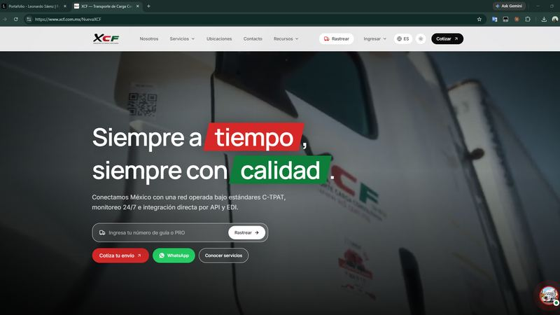
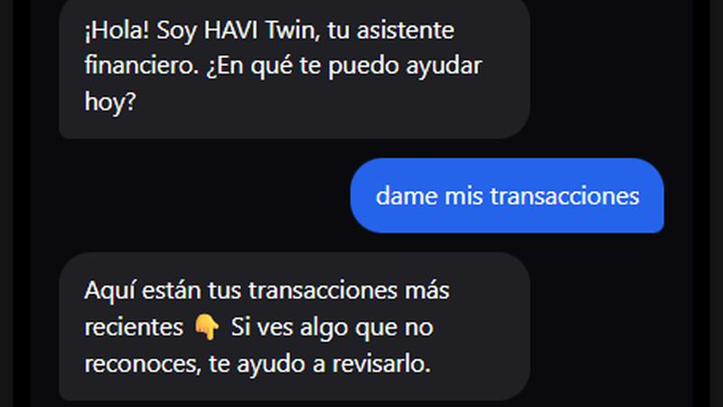
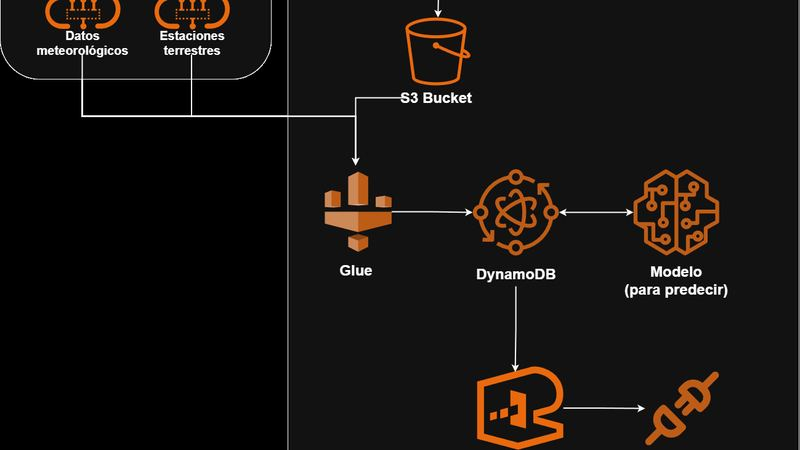
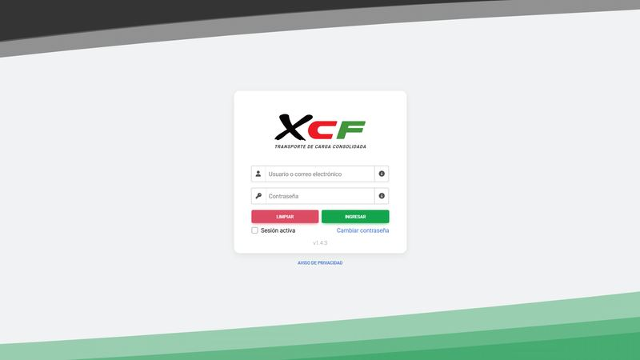
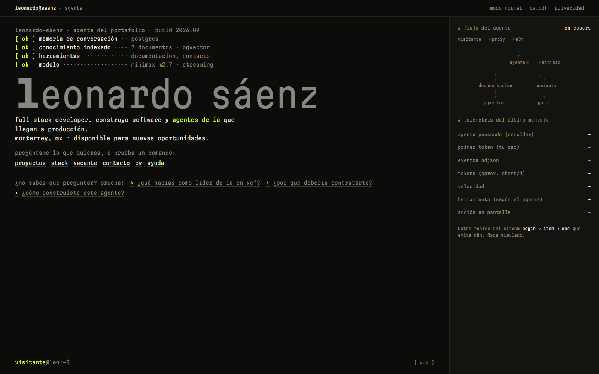
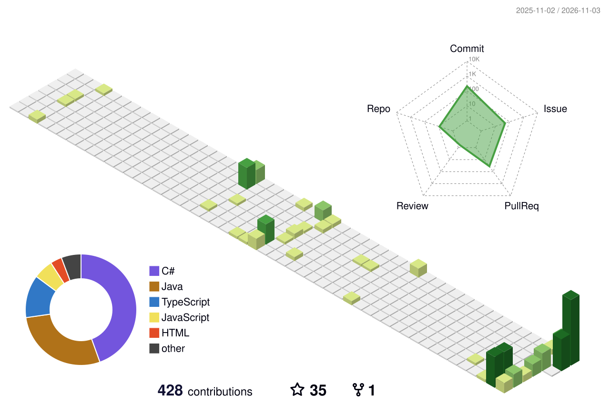

<div align="center">

<a href="https://leonardosaenz.com.mx/portafolio"></a>
<a href="https://www.linkedin.com/in/leonardos4enz/"></a>
<a href="mailto:leonardorsaenz@gmail.com"></a>


<br><br>

<picture>
  <source media="(prefers-color-scheme: dark)" srcset="assets/agents/hero-dark.svg">
  
</picture>

</div>

<br>

## `$ whoami`

<picture>
  <source media="(prefers-color-scheme: dark)" srcset="assets/agents/whoami-dark.svg">
  
</picture>

**Full Stack Developer & AI Engineer** — Computer Science graduate (UANL FCFM). I build software and AI agents that reach production: corporate web platforms, a full ERP, and agents that don't just chat — they **operate the UI, call real tools, and stream their work live**.

- 🟢 **Now:** available for new opportunities — full stack, AI agents, or both
- 🤖 **Previously:** AI Lead @ XCF (Jan 2025 – Sep 2026) — agentic assistants with n8n, RAG with pgvector, voice agents with ElevenLabs/RetellAI. Before that, project lead for XCF's ERP and legacy-system migration (since Apr 2023)
- 🧠 **Obsessed with:** agents that take real actions — tool-calling, generative UI, computer-use style navigation
- 🏆 **MLH prize winner** at NASA International Space Apps Challenge 2025
- 📍 Monterrey, Nuevo León, México · Spanish (native), English (intermediate)

<picture>
  <source media="(prefers-color-scheme: dark)" srcset="assets/agents/divider-dark.svg">
  
</picture>

## `$ ls ~/hackathons`

<div align="center">

</div>

- 🏆 **NASA International Space Apps Challenge 2025** — MLH prize: *Best Use of ElevenLabs*, with **A.E.R.I.S.** (AI + ML + NASA TEMPO satellite data)
- 🔟 **Datathon DSC 2026 (HeyBanco)** — Top 10 of 60+ teams with **HeyTwin**, team *Specters*

<br>

## `$ cat ~/stack`

<div align="center">
<picture>
  <source media="(prefers-color-scheme: dark)" srcset="assets/agents/stack-dark.svg">
  
</picture>
</div>

<br>

## `$ ls ~/featured-builds`

<picture>
  <source media="(prefers-color-scheme: dark)" srcset="assets/agents/projects-dark.svg">
  
</picture>

| Project | What it does | Stack |
|---|---|---|
| **[XCF 2026](https://www.xcf.com.mx/)** ⭐ | Corporate site I built for XCF with an **agentic AI assistant** that navigates the page and operates components (shipment tracking, quotes) on the user's behalf. Live map, i18n, dark mode. | `Next.js` `TypeScript` `.NET 10` `SQL Server` `n8n` |
| **[HeyTwin](https://github.com/leonardos4enz/Datathon-2026-Specters)** | Digital twin of 15,025 bank customers — HDBSCAN finds 6 real segments, Random Forest + Optuna predicts profiles in <50 ms, an LLM agent answers with live generative charts. **Top 10 of 60+ teams**, Datathon DSC 2026. | `Python` `FastAPI` `pgvector` `LangChain` `AWS` |
| **A.E.R.I.S.** | AI agent predicting air quality in real time from NASA TEMPO satellite data, with voice alerts for at-risk people. **🏆 MLH: Best Use of ElevenLabs**, NASA Space Apps 2025. | `Python` `AWS Lambda` `DynamoDB` `ML` `ElevenLabs` |
| **[XSLAYCC ERP](https://www.xcf.com.mx/xslaycc)** | Full ERP: purchasing, inventory & fleet management. 3-tier architecture (WEB / API / CLASSES) with AES-encrypted transport. Led the dev team with SCRUM. | `.NET 8` `C#` `SQL Server` `Azure DevOps` `IIS` |

<div align="center">
<table>
  <tr>
    <td align="center" width="50%">
      <a href="https://www.xcf.com.mx/"></a>
      <sub><b>XCF 2026</b> — agentic assistant operating the UI</sub>
    </td>
    <td align="center" width="50%">
      <a href="https://github.com/leonardos4enz/Datathon-2026-Specters"></a>
      <sub><b>HeyTwin</b> — generative UI over 15k customer profiles</sub>
    </td>
  </tr>
  <tr>
    <td align="center" width="50%">
      
      <sub><b>A.E.R.I.S.</b> — air-quality prediction from NASA TEMPO</sub>
    </td>
    <td align="center" width="50%">
      <a href="https://www.xcf.com.mx/xslaycc"></a>
      <sub><b>XSLAYCC</b> — ERP for XCF's daily operations</sub>
    </td>
  </tr>
</table>
</div>

<br>

## `$ open leonardosaenz.com.mx`

<picture>
  <source media="(prefers-color-scheme: dark)" srcset="assets/agents/portfolio-dark.svg">
  
</picture>

My portfolio is a product in itself, rebuilt from scratch in 2026 with two modes:

- **`/` — the agent.** The homepage is a terminal where you talk to a real AI agent that speaks as me. A side inspector animates the agent's flow and shows **live telemetry from the stream** (time to first token, NDJSON events, speed, tool used) — nothing simulated. When it mentions a project it draws annotated callouts over the screenshots, and it can **take control of the portfolio computer-use style**: opens it, scrolls, moves a cursor and highlights the section, handing control back the moment you touch the page. Voice input included.
- **`/portafolio` — the classic.** An editorial portfolio: full-width type, B/W photo, project index with cursor-following previews, timeline, skills and hackathons.

Under the hood: **ASP.NET Core 10 MVC** with a rate-limited streaming proxy → **n8n** AI Agent on **MiniMax M2.7** → memory in Postgres + **RAG on pgvector** (OpenAI embeddings) and a contact tool that emails me through Gmail. Zero external NuGet dependencies.

<div align="center">
<table>
  <tr>
    <td align="center" width="50%">
      <a href="https://leonardosaenz.com.mx/"></a>
      <sub><b>/</b> — terminal + agent inspector</sub>
    </td>
    <td align="center" width="50%">
      <a href="https://leonardosaenz.com.mx/portafolio"></a>
      <sub><b>/portafolio</b> — editorial mode</sub>
    </td>
  </tr>
</table>

<sub>👆 Click to visit — ask the agent <i>"¿por qué debería contratarte?"</i> and watch it work</sub>

<br><br>


<sub>⚡ This badge is generated live by my own site — an ASP.NET endpoint serving animated SVG with real uptime</sub>
</div>

<br>

## `$ htop --github`

<div align="center">

<picture>
  <source media="(prefers-color-scheme: dark)" srcset="https://streak-stats.demolab.com?user=leonardos4enz&hide_border=true&background=00000000&ring=FFFFFF&fire=FFFFFF&currStreakNum=FFFFFF&sideNums=FFFFFF&currStreakLabel=8A8A8A&sideLabels=8A8A8A&dates=555555&stroke=8A8A8A">
  
</picture>

<picture>
  <source media="(prefers-color-scheme: dark)" srcset="assets/agents/graph-dark.svg">
  
</picture>

<picture>
  <source media="(prefers-color-scheme: dark)" srcset="profile-3d-contrib/profile-night-green.svg">
  
</picture>

</div>

<br>

<div align="center">

```csharp
while (alive) { Build(); Learn(); Ship(); }
```

<sub>© Leonardo Sáenz · Monterrey, MX · handle is <b>leonardos4enz</b> — with a 4 😉</sub>

</div>
